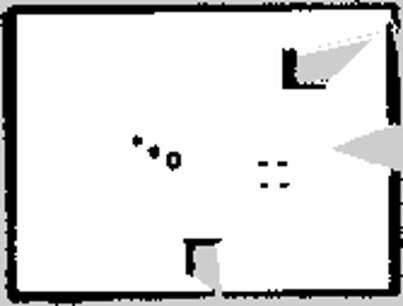
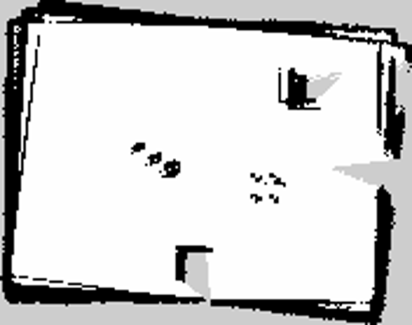

# Distinct Isaac geometry: two-lap mapping and separate-route localization — 2026-10-12

## Decision

The new pillar-cluster scene gives independent simulated evidence in favor of
the **experimental 1.0 m** SLAM Toolbox loop-search radius over the current
3.0 m setting. On the same two-lap raw bag, 1.0 m had lower trajectory error,
created a ground-truth-accurate explicit loop edge, and saved a visibly more
coherent map. Its pose graph also localized the separate interior route with
lower tail and heading error. **The production YAML was not changed.** Exact
Isaac odometry, one new scene, and timing-sensitive replay do not establish
hardware or Nav2-control readiness.

## Inputs and replay isolation

The Isaac-repo run `a595a9c` added an opt-in static, LiDAR-visible
three-pillar cluster, a two-lap mapping route, and a separate diagonal/interior
localization route, both starting at `(-0.5, -1.0)`. Its route/clearance
checks reported positive footprint margins. Raw bags were recorded on the
Jetson over a Tailscale DDS workaround, not a revalidated shared LAN:

| Input | Path | Duration | Scans | Odom / TF / clock |
| --- | --- | ---: | ---: | ---: |
| Mapping | `/home/nithish/jetauto_geometry_validation_20261012/mapping_bag` | 90.13 s | 898 | 5,409 each |
| Localization | `/home/nithish/jetauto_geometry_validation_20261012/localization_bag` | 53.67 s | 534 | 3,221 each |

Each bag has three `/tf_static` messages. The simulator-side checker found
every scan paired with odometry and maximum scan gaps of 0.1008 and 0.1018 s.
The source bags contain no earlier `/pose`, `/map`, or `map -> odom` output.
For extra isolation the localization bag was copied to
`/tmp/jetauto_geometry_localization_clean_20261012`, retaining only
`/clock /scan /tf /tf_static` and storing unchanged `/odom/wheel` as
`/validation/reference_odom`. No stale map transform was removed (count zero).

The pinned Humble SLAM Toolbox 2.6.10 overlay had its tracked heading-aware
scan fix and the [optional Karto diagnostic probe](../../patches/slam_toolbox/2.6.10-loop-closure-probe.patch)
for mapping. Both mapping replays were 1×, used isolated ROS domains, the same
installed mapping YAML and `use_sim_time=true`, and differed only in
`loop_search_maximum_distance`. The source bags and production YAML were not
modified. Output topic recording began before bag playback.

## Mapping comparison

All published `/pose` stamps matched Isaac odometry within 0.004 s. Different
callback timing gave 392 poses at 1.0 m and 395 at 3.0 m. A separate
same-time comparison pairs 355 poses within 0.05 s.

| Metric | 1.0 m | 3.0 m |
| --- | ---: | ---: |
| Position error, median / p95 / maximum | **0.0446 / 0.2338 / 0.2487 m** | 0.1613 / 0.4746 / 0.4879 m |
| Heading error, median / p95 / maximum | **0.0098 / 0.0443 / 0.0593 rad** | 0.0593 / 0.1221 / 0.1291 rad |
| Paired-time position error, median / p95 | **0.0513 / 0.2383 m** | 0.1317 / 0.4441 m |
| Paired-time heading error, median / p95 | **0.0106 / 0.0453 rad** | 0.0558 / 0.1082 rad |
| Fine-accepted explicit `TryCloseLoop` candidates / new edges | **1 / 1** | 0 / 0 |
| All newly inserted graph edges | 781 | 470 |
| Map size at 0.05 m/cell | 167 × 127 | 176 × 139 |

At 1.0 m, scan 159 at 36.1501 s linked to scan 0 at 0.35 s. The candidate
passed the link gate and `AddEdge` confirmed creation. Its proposed relative
pose differed from Isaac truth by **0.0156 m and 0.0035 rad**; the scan
centers were 1.2997 m apart. Thus center separation alone would have been a
misleading false-positive test. The 3.0 m run had no fine-accepted explicit
candidate; its probe's sampled candidate-chain checks were empty.

The 1.0 m log also records 322 graph edges whose scan IDs differ by more
than 100, including links from scan 0 to late scans 380–391. The 3.0 m log
has no edge with that ID separation. These insertion markers show long-range
graph connectivity; they do **not** expose each edge's relative transform or
prove each edge accurate. Only the explicit scan-159 edge was audited against
ground truth. The 1.0 m map shows one room perimeter and separate pillar
returns. The 3.0 m map has split/doubled wall sections and offset pillar
returns on visual inspection. These are qualitative map checks, not a
pixel-level comparison with simulator ground-truth occupancy.

| 1.0 m saved map | 3.0 m saved map |
| --- | --- |
|  |  |

Both `serialize_map` calls returned `result=0`, and both occupancy maps were
saved successfully. The `.posegraph`, `.data`, `.pgm`, `.yaml`, logs, and
recorded output bags are under `/tmp/jetauto_geometry_radius{1,3}_20261012/`.
The `/tmp` artifacts may disappear after reboot.

## Saved-map localization on the other route

Each fresh `localization_slam_toolbox_node` loaded its matching saved pose
graph, started at the shared `(-0.5, -1.0, 0)` pose, and replayed the clean
localization bag at 1× on a separate ROS domain. All output poses matched
Isaac odometry within 0.002 s; both runs published fresh poses through
53.15 s, near the 53.73 s final odometry sample. Callback timing gave 167
poses for the 1.0 m map and 219 for the 3.0 m map. The same-time comparison
pairs 96 poses within 0.05 s.

| Metric | 1.0 m map | 3.0 m map |
| --- | ---: | ---: |
| Position error, median / p95 / maximum | **0.0434 / 0.1602 / 0.1788 m** | 0.0478 / 0.2257 / 0.2595 m |
| Heading error, median / p95 / maximum | **0.0126 / 0.0306 / 0.0350 rad** | 0.0642 / 0.0880 / 0.0957 rad |
| Paired-time position error, median / p95 | **0.0406 / 0.1602 m** | 0.0453 / 0.2416 m |
| Paired-time heading error, median / p95 | **0.0121 / 0.0290 rad** | 0.0676 / 0.0893 rad |

Localization output, logs, and parameter checks are under
`/tmp/jetauto_geometry_localization_radius{1,3}_20261012/`.

## Reproduce and limits

The temporary replay harnesses are
`/tmp/jetauto_loop_radius_replay_20261011.sh` and
`/tmp/jetauto_geometry_localization_20261012.sh`. They fail if an output
directory already exists and stop their launched nodes and recorders at exit.
For example, after building the optional probe and sourcing ROS:

```bash
bash /tmp/jetauto_loop_radius_replay_20261011.sh \
  /home/nithish/jetauto_geometry_validation_20261012/mapping_bag \
  /tmp/jetauto_geometry_radius1_20261012 105 1.0 1.0
python3 rosbag/audit_karto_loop_matches.py \
  /home/nithish/jetauto_geometry_validation_20261012/mapping_bag \
  /tmp/jetauto_geometry_radius1_20261012/mapper_console.log
python3 rosbag/analyze_mapping_pose.py \
  /home/nithish/jetauto_geometry_validation_20261012/mapping_bag \
  /tmp/jetauto_geometry_radius1_20261012/pose_bag
```

The temporary `/tmp/jetauto_geometry_compare_20261012.py` produced the
same-time comparisons; it never changed a bag. The optional probe was
removed after this experiment and the normal heading-fix-only overlay was
rebuilt. The installed Karto library contains no probe marker strings; the
six audit unit tests and `git diff --check` pass. All replay processes were
stopped. No Nav2 planner/controller,
physical base, realistic odometry drift or sensor noise, or shared-LAN
throughput test was exercised. The new scene supports continued 1.0 m
evaluation, **not** a production-default or safety claim.

The same 1.0 m saved map subsequently passed a
[planner-only Nav2 replay](isaac_geometry_planner_only_2026-10-12.md) on the
independent interior route; no motion control was enabled.
A later [smooth wheel-TF drift replay](isaac_live_start_planner_tf_2026-10-13.md)
kept saved-map localization bounded with 0.583 m injected translation drift;
stochastic noise and hardware behavior remain untested.
